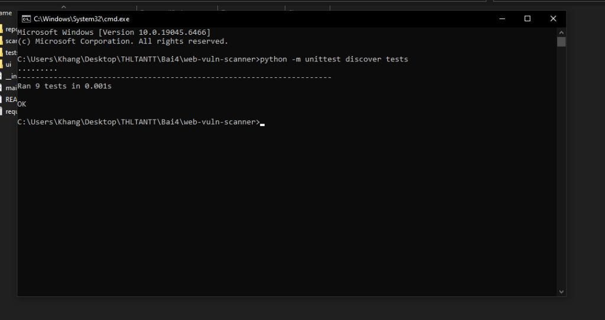
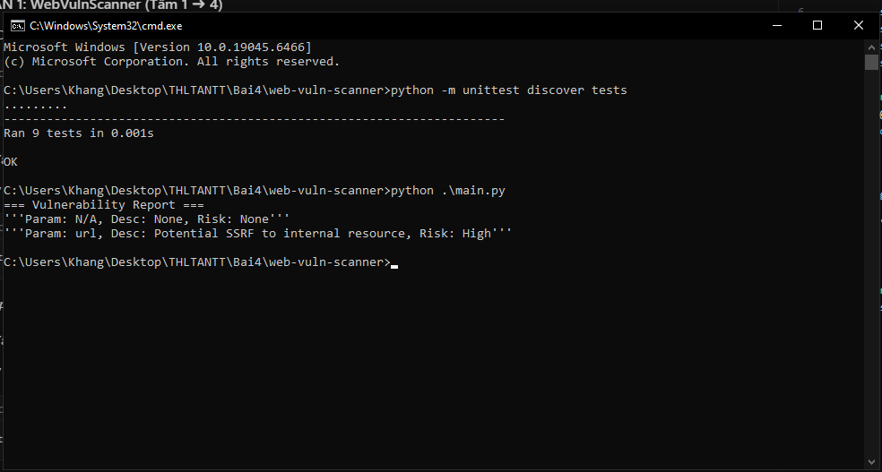
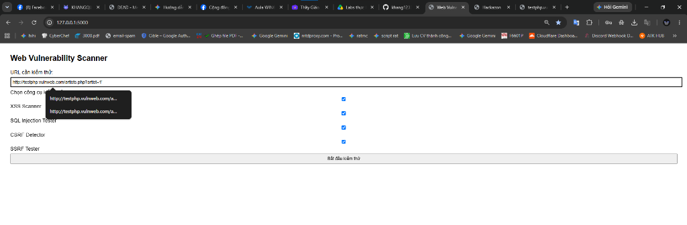
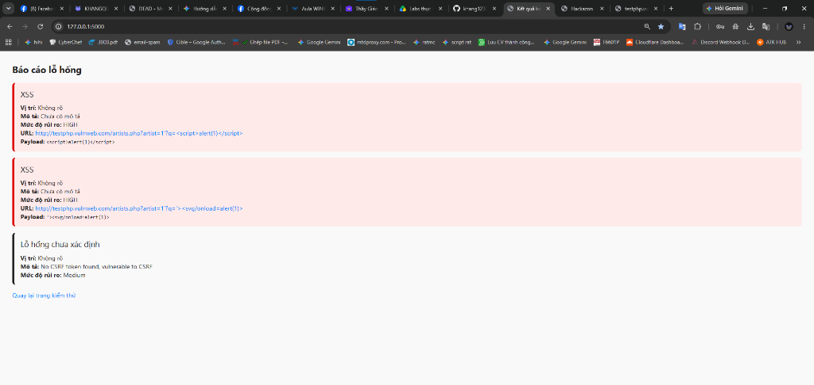
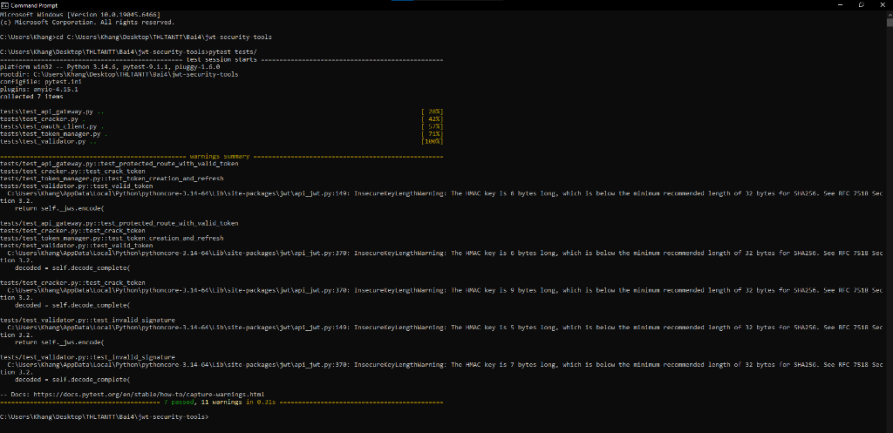
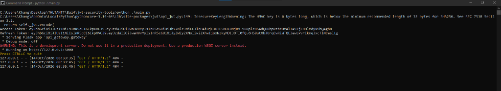
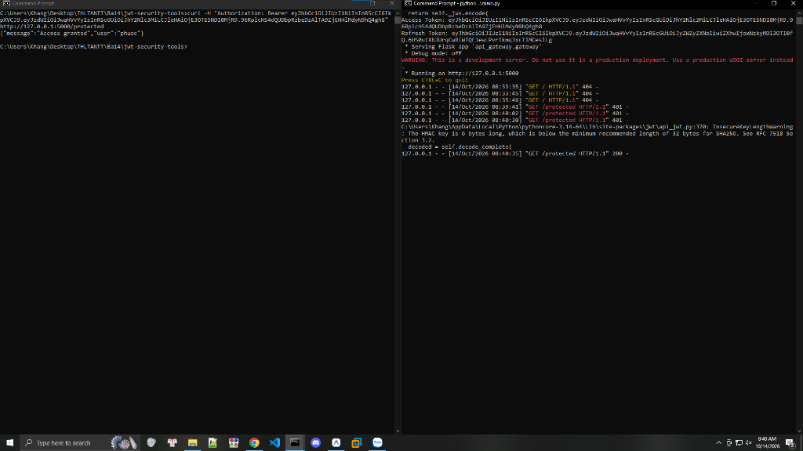

### Họ và Tên: Trần Minh Khang
### MSSV: 2387700027

# BÀI 4: BẢO MẬT WEB APP VÀ API
## BÁO CÁO TỔNG QUAN QUÉT LỖ HỔNG WEB (XSS, SQLi, CSRF, SSRF) & AN NINH XÁC THỰC TOKEN (JWT & OAUTH 2.0)

---

## 1. Giới thiệu tổng quan

Bài thực hành số 4 tập trung vào việc nghiên cứu bản chất các lỗ hổng bảo mật phổ biến nhất trên ứng dụng Web theo xếp hạng OWASP Top 10, đồng thời xây dựng giải pháp phân tích an ninh xác thực cho kiến trúc RESTful API hiện đại dựa trên chuẩn **JWT (JSON Web Token)** và **OAuth 2.0**. Bài thực hành gồm hai hợp phần trọng tâm:

1. **WebVulnScanner (`Bai4/web-vuln-scanner`):** Xây dựng bộ công cụ quét lỗ hổng ứng dụng web tự động bao gồm:
   * **XSSScanner:** Phát hiện lỗ hổng Cross-Site Scripting phản hồi (Reflected XSS) thông qua thư viện payload chuẩn hóa (`<script>`, `<svg>`).
   * **SQLInjectionTester:** Kiểm thử phát hiện dấu hiệu tiêm mã lệnh SQL thông qua phân tích tham số URL và các payload boolean-based / union-based.
   * **CSRFDetector:** Phân tích mã nguồn HTML biểu mẫu form, kiểm tra sự hiện diện của các Anti-CSRF Token (`csrf_token`, `_csrf`, `csrfmiddlewaretoken`).
   * **SSRFTester:** Phát hiện nguy cơ tấn công Server-Side Request Forgery khi tham số truyền vào chứa địa chỉ IP mạng nội bộ (Loopback, RFC 1918 Private Ranges).
   * **ReportGenerator:** Tổng hợp các phát hiện rủi ro, phân loại mức độ nghiêm trọng (Critical, High, Medium, Low) và xuất kết quả ra bảng điều khiển hoặc giao diện Web trực quan (Flask UI).
2. **JWTSecure (`Bai4/jwt-security-tools`):** Xây dựng bộ công cụ kiểm thử và bảo vệ xác thực API với JWT:
   * **APIGateway:** Cổng API bảo vệ endpoint nghiệp vụ `/protected`, trích xuất `Authorization: Bearer <token>`, thẩm định chữ ký và giải mã danh tính người dùng.
   * **JWTCracker:** Công cụ tấn công từ điển bẻ khóa HMAC secret yếu sử dụng kỹ thuật xử lý đa luồng (`concurrent.futures.ThreadPoolExecutor`).
   * **JWTValidator:** Kiểm tra tính toàn vẹn của Token, phát hiện token giả mạo chữ ký (`InvalidSignatureError`) hoặc token đã hết hạn sử dụng (`ExpiredSignatureError`).
   * **OAuthClient:** Mô phỏng Client OAuth 2.0 triển khai luồng chuẩn **Authorization Code Flow** (tạo Authorization URL và trao đổi Authorization Code lấy Access Token).
   * **TokenManager:** Quản lý vòng đời token, tự động phát hành cặp khóa Access Token (thời hạn ngắn, 15 phút) và Refresh Token (thời hạn dài, 24 giờ), hỗ trợ cơ chế cấp mới (Refresh Token Flow).

---

## 2. Cấu trúc thư mục Bài 4

```text
Bai4/
├── web-vuln-scanner/                   # Hợp phần 1: Bộ công cụ quét lỗ hổng ứng dụng Web
│   ├── report/
│   │   ├── __init__.py                 # Khởi tạo package report
│   │   └── report_generator.py         # Module tổng hợp và phân loại danh sách lỗ hổng
│   ├── scanners/
│   │   ├── __init__.py                 # Khởi tạo package scanners
│   │   ├── csrf_detector.py            # Quét kiểm tra bảo vệ CSRF trên form HTML
│   │   ├── sql_injection_tester.py     # Kiểm thử tham số URL với các payload SQLi
│   │   ├── ssrf_tester.py              # Kiểm tra tham số URL nhắm vào địa chỉ IP nội bộ
│   │   └── xss_scanner.py              # Thăm dò lỗ hổng phản hồi mã độc XSS qua HTTP GET
│   ├── tests/
│   │   ├── __init__.py                 # Khởi tạo package tests
│   │   ├── test_csrf.py                # Unit test kiểm tra CSRF Detector
│   │   ├── test_sql_injection.py       # Unit test kiểm tra SQL Injection Tester
│   │   ├── test_ssrf.py                # Unit test kiểm tra SSRF Tester
│   │   ├── test_xss.py                 # Unit test kiểm tra XSS Scanner (Mock requests)
│   │   └── test_report.py              # Unit test kiểm tra Report Generator
│   ├── ui/
│   │   ├── templates/
│   │   │   ├── index.html              # Giao diện biểu mẫu nhập URL và chọn scanner
│   │   │   └── result.html             # Giao diện hiển thị báo cáo lỗ hổng chi tiết
│   │   └── app.py                      # Máy chủ Flask phục vụ Web UI kiểm thử lỗ hổng
│   ├── main.py                         # Kịch bản dòng lệnh chạy tổng hợp 4 module scanner
│   ├── requirements.txt                # Danh sách thư viện phụ thuộc (Flask)
│   └── README.md                       # Báo cáo kỹ thuật chi tiết WebVulnScanner
├── jwt-security-tools/                 # Hợp phần 2: Bộ công cụ bảo mật xác thực JWT & OAuth 2.0
│   ├── api_gateway/
│   │   ├── __init__.py                 # Khởi tạo package api_gateway
│   │   └── gateway.py                  # API Gateway xác thực Bearer Token trên Flask
│   ├── jwt_cracker/
│   │   ├── __init__.py                 # Khởi tạo package jwt_cracker
│   │   └── cracker.py                  # Bẻ khóa secret JWT bằng từ điển đa luồng
│   ├── jwt_validator/
│   │   ├── __init__.py                 # Khởi tạo package jwt_validator
│   │   └── validator.py                # Thẩm định chữ ký số và thời hạn hiệu lực của JWT
│   ├── oauth_client/
│   │   ├── __init__.py                 # Khởi tạo package oauth_client
│   │   └── client.py                   # Mô phỏng OAuth 2.0 Client (Authorization Code Flow)
│   ├── token_manager/
│   │   ├── __init__.py                 # Khởi tạo package token_manager
│   │   └── manager.py                  # Quản lý phát hành, cấp mới và thời hạn Token
│   ├── tests/
│   │   ├── __init__.py                 # Khởi tạo package tests
│   │   ├── test_api_gateway.py         # Kiểm thử bảo vệ endpoint API Gateway
│   │   ├── test_cracker.py             # Kiểm thử bẻ khóa secret bằng từ điển
│   │   ├── test_oauth_client.py        # Kiểm thử sinh URL ủy quyền OAuth 2.0
│   │   ├── test_token_manager.py       # Kiểm thử tạo và làm mới Access Token
│   │   └── test_validator.py           # Kiểm thử thẩm định Token hợp lệ và sai chữ ký
│   ├── main.py                         # Kịch bản khởi chạy hệ thống TokenManager & Gateway
│   ├── pytest.ini                      # Cấu hình đường dẫn pythonpath cho Pytest
│   ├── requirements.txt                # Danh sách gói phụ thuộc (PyJWT, requests, flask, pytest)
│   └── README.md                       # Báo cáo kỹ thuật chi tiết JWTSecure
└── images/                             # Thư mục lưu trữ hình ảnh minh chứng thực nghiệm
    ├── 01_unittest_webvuln.png         # Kết quả chạy 9/9 Unittests của WebVulnScanner
    ├── 02_main_webvuln.png             # Kết quả chạy kịch bản chính main.py của WebVulnScanner
    ├── 03_web_ui_form.png              # Giao diện Web Vulnerability Scanner tại localhost:5000
    ├── 04_web_ui_result.png            # Kết quả quét lỗ hổng hiển thị trên giao diện Web UI
    ├── 05_pytest_jwt.png               # Kết quả chạy 7/7 tests qua Pytest của JWTSecure
    ├── 06_main_jwt_token.png           # Chạy main.py sinh Access Token & Refresh Token
    └── 07_curl_protected_api.png      # Kết quả gọi curl xác thực Bearer Token vào API Gateway
```

---

## 3. Bảng tổng hợp Lỗ hổng & Công nghệ sử dụng

| Phân hệ | Thành phần | Kỹ thuật / Chuẩn | Thư viện triển khai | Đặc tính bảo mật cốt lõi |
|---|---|---|---|---|
| **WebVulnScanner** | XSS Scanner | **Reflected XSS Detection** | `requests` | Gửi payload `<script>` và `<svg>`, đối soát phản hồi trong DOM để phát hiện chèn mã độc. |
| **WebVulnScanner** | SQLi Tester | **Pattern Matching SQLi** | `urllib.parse` | Phát hiện chuỗi tiêm mã lệnh kinh điển (`' OR '1'='1`, `DROP TABLE`, `UNION SELECT`). |
| **WebVulnScanner** | CSRF Detector | **Anti-CSRF Token Heuristics** | `re` (Regex) | Quét kiểm tra form HTML thiếu token bảo vệ CSRF (`csrf_token`, `_csrf`). |
| **WebVulnScanner** | SSRF Tester | **Private IP Regex Detection** | `re` (Regex) | Phát hiện tham số URL nhắm vào IP Loopback (`127.0.0.1`, `localhost`) hoặc mạng riêng (RFC 1918). |
| **WebVulnScanner** | Web UI & Report | **Risk Categorization & Flask** | `flask`, `report_generator` | Giao diện kiểm thử trực quan, phân loại mức độ rủi ro Critical / High / Medium / Low. |
| **JWTSecure** | API Gateway | **Bearer Token Auth Filter** | `flask`, `jwt` (PyJWT) | Chặn truy cập trái phép (401 Unauthorized) nếu thiếu token hoặc chữ ký không hợp lệ. |
| **JWTSecure** | JWT Cracker | **Multi-threaded Dictionary Attack** | `concurrent.futures` | Tận dụng `ThreadPoolExecutor` dò tìm khóa bí mật HMAC nhanh gấp nhiều lần so với tuần tự. |
| **JWTSecure** | JWT Validator | **Signature & Expiration Verification**| `jwt.exceptions` | Phân biệt rõ ràng lỗi hết hạn (`ExpiredSignatureError`) và lỗi bị sửa đổi (`InvalidSignatureError`). |
| **JWTSecure** | OAuth 2.0 Client | **Authorization Code Flow** | `requests`, `urllib.parse` | Tuân thủ khuyến nghị RFC 6749, phân tách quyền hạn giữa máy khách và máy chủ ủy quyền. |
| **JWTSecure** | Token Manager | **Dual-Token Lifecycle (Access + Refresh)**| `jwt`, `datetime` | Hạn chế tối đa cửa sổ tấn công của Access Token (15 phút), cho phép thu hồi phiên bằng Refresh Token. |

---

## 4. Hướng dẫn cài đặt và chạy thử nghiệm

### 4.1. Hợp phần 1: WebVulnScanner (`Bai4/web-vuln-scanner`)
```bash
# Di chuyển vào thư mục bài tập
cd Bai4/web-vuln-scanner

# 1. Chạy toàn bộ bộ kiểm thử Unittest (9/9 passed)
python -m unittest discover tests

# 2. Chạy kịch bản kiểm tra độc lập dòng lệnh
python .\main.py

# 3. Khởi động giao diện Web UI
python .\ui\app.py
# Mở trình duyệt truy cập: http://127.0.0.1:5000
```

### 4.2. Hợp phần 2: JWTSecure (`Bai4/jwt-security-tools`)
```bash
# Di chuyển vào thư mục bài tập
cd ../jwt-security-tools

# 1. Chạy kiểm thử tự động với Pytest (7/7 passed)
pytest tests/

# 2. Chạy ứng dụng máy chủ API Gateway & sinh Token
python .\main.py

# 3. Mở một cửa sổ Terminal khác để kiểm thử xác thực API Gateway qua curl:
curl -H "Authorization: Bearer <access_token_vua_tao>" http://127.0.0.1:5000/protected
```

---

## 5. Danh mục hình ảnh thực nghiệm (Output Screenshots)

Dưới đây là các vị trí hình ảnh minh chứng cho từng bước thực nghiệm của Bài 4:

### 5.1. Kết quả kiểm thử Unittest (WebVulnScanner)
* **Mô tả:** Chạy lệnh `python -m unittest discover tests` kiểm thử 9/9 test cases thành công (CSRF, SQL Injection, SSRF, XSS, Report).
* **Đường dẫn ảnh:** `images/01_unittest_webvuln.png`



---

### 5.2. Chạy kịch bản chính `main.py` (WebVulnScanner)
* **Mô tả:** Thực thi kịch bản tổng hợp quét đồng thời 4 module và xuất kết quả phát hiện ra console.
* **Đường dẫn ảnh:** `images/02_main_webvuln.png`



---

### 5.3. Giao diện Web Vulnerability Scanner (`ui/app.py`)
* **Mô tả:** Truy cập `http://127.0.0.1:5000` trên trình duyệt, điền URL mục tiêu và chọn các scanner kiểm thử.
* **Đường dẫn ảnh:** `images/03_web_ui_form.png`



---

### 5.4. Kết quả quét lỗ hổng trên giao diện Web UI
* **Mô tả:** Kết quả phân tích hiển thị danh sách các lỗ hổng phát hiện được phân cấp theo màu sắc rủi ro (HIGH / MEDIUM).
* **Đường dẫn ảnh:** `images/04_web_ui_result.png`



---

### 5.5. Kết quả kiểm thử Pytest (JWTSecure)
* **Mô tả:** Chạy lệnh `pytest tests/` kiểm tra 7/7 bài test cho API Gateway, Cracker, OAuth Client, Token Manager và Validator.
* **Đường dẫn ảnh:** `images/05_pytest_jwt.png`



---

### 5.6. Khởi chạy `main.py` sinh Token và bật API Gateway
* **Mô tả:** Chạy `python .\main.py`, hệ thống in ra Access Token và Refresh Token, đồng thời kích hoạt cổng API Gateway lắng nghe tại cổng 5000.
* **Đường dẫn ảnh:** `images/06_main_jwt_token.png`



---

### 5.7. Kiểm tra xác thực Bearer Token qua lệnh `curl`
* **Mô tả:** Gửi yêu cầu HTTP GET kèm header `Authorization: Bearer <access_token>` vào endpoint `/protected` và nhận phản hồi `{"message": "Access granted", "user": "..."}`.
* **Đường dẫn ảnh:** `images/07_curl_protected_api.png`



---

## 6. Liên kết báo cáo kỹ thuật chuyên sâu

* 👉 **Xem chi tiết Hợp phần 1:** [Báo cáo kỹ thuật WebVulnScanner](web-vuln-scanner/README.md)
* 👉 **Xem chi tiết Hợp phần 2:** [Báo cáo kỹ thuật JWTSecure](jwt-security-tools/README.md)
