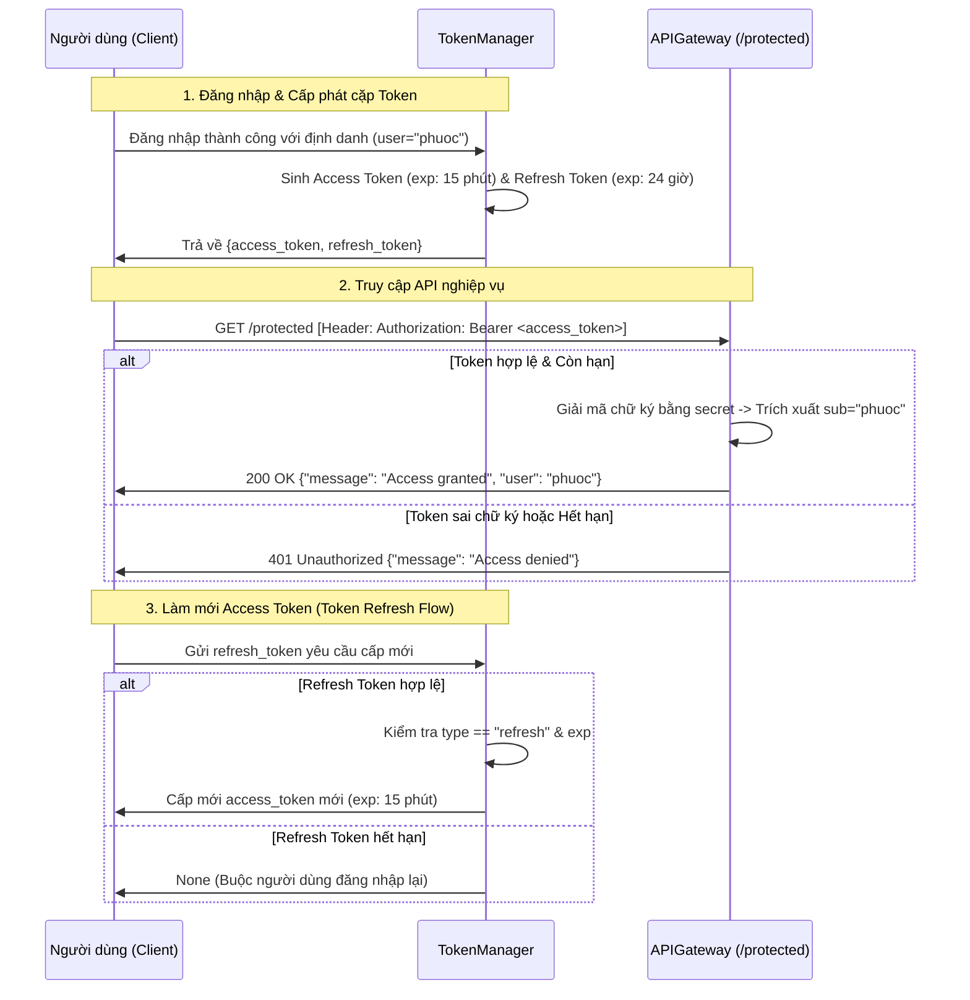

### Họ và Tên: Trần Minh Khang
### MSSV: 2387700027

# BÁO CÁO KỸ THUẬT: JWTSECURE
## PHÂN TÍCH AN NINH XÁC THỰC API VỚI JWT (RFC 7519) VÀ GIAO THỨC ỦY QUYỀN OAUTH 2.0 (RFC 6749)

---

## 1. Giới thiệu và Kiến trúc Hệ thống `jwt-security-tools`

`jwt-security-tools` là bộ thư viện bảo mật xác thực ứng dụng hiện đại, mô phỏng đầy đủ kiến trúc xác thực token không trạng thái (Stateless Token-based Authentication) và cơ chế ủy quyền phân tán OAuth 2.0:

```text
jwt-security-tools/
├── api_gateway/
│   ├── __init__.py                 # Khởi tạo package api_gateway
│   └── gateway.py                  # API Gateway xác thực Bearer Token bảo vệ endpoint /protected
├── jwt_cracker/
│   ├── __init__.py                 # Khởi tạo package jwt_cracker
│   └── cracker.py                  # Bẻ khóa secret HMAC bằng từ điển đa luồng (ThreadPoolExecutor)
├── jwt_validator/
│   ├── __init__.py                 # Khởi tạo package jwt_validator
│   └── validator.py                # Thẩm định chữ ký số và kiểm tra hạn sử dụng của JWT
├── oauth_client/
│   ├── __init__.py                 # Khởi tạo package oauth_client
│   └── client.py                   # Mô phỏng OAuth 2.0 Client (Authorization Code Flow)
├── token_manager/
│   ├── __init__.py                 # Khởi tạo package token_manager
│   └── manager.py                  # Quản lý phát hành, làm mới (refresh) và kiểm soát hạn dùng Token
├── tests/
│   ├── __init__.py                 # Khởi tạo package tests
│   ├── test_api_gateway.py         # Kiểm thử bảo vệ route với Bearer token hợp lệ / không hợp lệ
│   ├── test_cracker.py             # Kiểm thử tấn công brute-force bẻ khóa secret thành công
│   ├── test_oauth_client.py        # Kiểm thử sinh Authorization URL chuẩn OAuth 2.0
│   ├── test_token_manager.py       # Kiểm thử tạo và làm mới Access Token từ Refresh Token
│   └── test_validator.py           # Kiểm thử thẩm định Token hợp lệ và từ chối token sai chữ ký
├── main.py                         # Kịch bản khởi chạy hệ thống TokenManager & Gateway
├── pytest.ini                      # Cấu hình pythonpath phục vụ kiểm thử pytest
└── requirements.txt                # Danh sách gói phụ thuộc (PyJWT, requests, flask, pytest)
```

---

## 2. Sơ đồ Luồng Xác thực Token & Quản lý Vòng đời (Dual-Token Pattern)



---

## 3. Phân tích chi tiết các Module Kỹ thuật

### 3.1. Cổng API Gateway (`api_gateway/gateway.py`)
* Sử dụng Flask framework cung cấp endpoint `/protected`.
* **Cơ chế xác thực:** Trích xuất chuỗi token từ header HTTP `Authorization: Bearer <token>`. Gọi thư viện `jwt.decode(token, self.secret, algorithms=[self.algorithm])`.
* Nếu chữ ký hợp lệ và token chưa hết hạn, endpoint trả về mã `200` kèm thông tin định danh `payload["sub"]`. Nếu xảy ra ngoại lệ `jwt.InvalidTokenError`, endpoint lập tức ngắt kết nối với mã lỗi `401 Unauthorized`.

### 3.2. Công cụ bẻ khóa từ điển đa luồng (`jwt_cracker/cracker.py`)
* **Kỹ thuật tấn công:** Khi khóa bí mật HMAC SHA-256 (`HS256`) bị đặt ở mức độ yếu (ví dụ: `secret`, `123456`, `password`), kẻ tấn công có thể thử giải mã chữ ký bằng danh sách từ điển (Wordlist Attack).
* **Tối ưu hóa đa luồng:** Module sử dụng `concurrent.futures.ThreadPoolExecutor(max_workers=10)` phân phối việc thử các khóa đồng thời trên 10 worker threads, tăng tốc độ dò khóa gấp nhiều lần so với vòng lặp đơn luồng truyền thống.

### 3.3. Module thẩm định Token (`jwt_validator/validator.py`)
* Thẩm định chính xác từng loại ngoại lệ của chuẩn JWT:
  * `ExpiredSignatureError`: Token đã hết hạn sử dụng (`exp` < thời điểm hiện tại).
  * `InvalidSignatureError`: Token bị kẻ tấn công thay đổi nội dung Payload hoặc giả mạo chữ ký.
  * `InvalidTokenError`: Cấu trúc Token không đúng định dạng Base64URL 3 phần.

### 3.4. Module quản lý vòng đời Token (`token_manager/manager.py`)
* **Mô hình Dual-Token:** Giải quyết mâu thuẫn giữa tính bảo mật và trải nghiệm người dùng:
  * **Access Token:** Mang thời hạn ngắn (`access_exp=15` phút) nhằm giảm thiểu thiệt hại nếu token vô tình bị rò rỉ qua mạng hoặc log.
  * **Refresh Token:** Mang thời hạn dài (`refresh_exp=1440` phút = 24 giờ), lưu trữ an toàn để đổi lấy Access Token mới mà người dùng không cần nhập lại mật khẩu.

---

## 4. Kết quả thực nghiệm (Output Minh chứng)

### 4.1. Chạy kiểm thử tự động với Pytest (7/7 Passed)
Lệnh thực thi:
```bash
pytest tests/
```
Output:
```text
============================= test session starts =============================
platform win32 -- Python 3.14.6, pytest-9.1.1, pluggy-1.6.0
rootdir: C:\Users\Khang\Documents\antigravity\cool-bell\Bai4\jwt-security-tools
configfile: pytest.ini
collected 7 items

tests\test_api_gateway.py ..                                             [ 28%]
tests\test_cracker.py .                                                  [ 42%]
tests\test_oauth_client.py .                                             [ 57%]
tests\test_token_manager.py .                                            [ 71%]
tests\test_validator.py ..                                               [100%]

======================= 7 passed, 11 warnings in 0.28s ========================
```


---

### 4.2. Khởi chạy `main.py` sinh Token và kích hoạt API Gateway
Lệnh thực thi:
```bash
python .\main.py
```


---

### 4.3. Kiểm tra chứng thực Bearer Token qua lệnh `curl`
Lệnh thực thi trên Command Prompt:
```cmd
curl -H "Authorization: Bearer <access_token>" http://127.0.0.1:5000/protected
```
Output:
```json
{"message": "Access granted", "user": "phuoc"}
```


