### Họ và Tên: Trần Minh Khang
### MSSV: 2387700027

# BÀI 5: PHÂN TÍCH VÀ KIỂM THỬ BẢO MẬT (SAST VÀ DAST)
## BÁO CÁO TỔNG QUAN KIỂM THỬ TĨNH (SAST-TOOL) VÀ KIỂM THỬ ĐỘNG (DAST-TOOL)

---

## 1. Giới thiệu tổng quan

Bài thực hành số 5 tập trung vào hai phương pháp kiểm thử an ninh phần mềm trọng yếu: **Static Application Security Testing (SAST - Kiểm thử bảo mật tĩnh)** và **Dynamic Application Security Testing (DAST - Kiểm thử bảo mật động)**:

1. **SAST-Tool (`Bai5/sast-tool`):** Phân tích mã nguồn tĩnh khi chương trình chưa thực thi:
   * **AST Analyzer:** Duyệt cây cú pháp trừu tượng (AST) để phát hiện các hàm thực thi nguy hiểm (`eval`, `exec`).
   * **Vuln Pattern Matcher:** So khớp Regex phát hiện thông tin nhạy cảm (hardcoded passwords, API keys) và thư viện không an toàn (`pickle`, `yaml`).
   * **Security Rule Engine:** Phân loại và gán mức độ nghiêm trọng (High, Medium, Low) theo chuẩn bảo mật.
   * **Code Quality Checker:** Kiểm tra chuẩn mã nguồn và chất lượng mã với Flake8 (PEP 8).
   * **SARIF Reporter:** Xuất báo cáo theo định dạng chuẩn quốc tế SARIF 2.1.0, tương thích Visual Studio Code SARIF Viewer.

2. **DAST-Tool (`Bai5/dast-tool`):** Giám sát và phân tích an ninh ứng dụng trong thời gian thực thi (Runtime):
   * **Runtime Monitor:** Giám sát mức tiêu thụ tài nguyên phần cứng (% CPU, RAM) và danh sách tệp tin đang mở.
   * **Memory Analyzer:** Phát hiện rò rỉ bộ nhớ (Memory Leak) và kiểm tra nguy cơ tràn số nguyên 64-bit.
   * **Network Traffic Analyzer:** Theo dõi lưu lượng mạng gửi/nhận (Bytes Sent/Received) theo từng card mạng.
   * **Security Behavior Checker:** Giám sát và phát hiện các lệnh gọi hệ thống nguy hiểm (`os.system`, `subprocess`).
   * **Virtual Sandbox:** Cô lập ứng dụng trong môi trường hộp cát an toàn (thư mục tạm và biến môi trường cách ly).
   * **Flask REST API:** Cung cấp các endpoint API giám sát trạng thái an ninh thời gian thực.

---

## 2. Cấu trúc thư mục Bài 5

```text
Bai5/
├── sast-tool/                             # Hợp phần 1: Công cụ kiểm thử bảo mật tĩnh
│   ├── examples/
│   │   ├── vulnerable_01.py              # Mã nguồn mẫu 1 (eval, hardcoded password, pickle)
│   │   └── vulnerable_02.py              # Mã nguồn mẫu 2 (dangerous eval, exec, read_file)
│   ├── rules/
│   │   └── default_rules.json            # Cơ sở dữ liệu luật phân loại rủi ro (high, medium, low)
│   ├── sast_tool/
│   │   ├── __init__.py
│   │   ├── ast_analyzer.py               # Phân tích AST phát hiện hàm nguy hiểm
│   │   ├── code_quality_checker.py       # Kiểm tra chất lượng mã với Flake8
│   │   ├── sarif_reporter.py             # Xuất báo cáo chuẩn SARIF 2.1.0
│   │   ├── security_rule_engine.py       # Ánh xạ lỗ hổng với mức độ nghiêm trọng
│   │   ├── vuln_pattern_matcher.py       # So khớp mẫu Regex tìm mật khẩu & thư viện nguy hiểm
│   │   └── main.py                       # CLI điều phối quy trình phân tích SAST
│   ├── tests/                            # Unit tests cho SAST (6/6 passed)
│   └── requirements.txt                  # Thư viện phụ thuộc: flake8, jsonschema, pytest
│
├── dast-tool/                             # Hợp phần 2: Công cụ kiểm thử bảo mật động
│   ├── app.py                            # Flask REST API giám sát thời gian thực
│   ├── main.py                           # CLI thực thi giám sát động toàn diện
│   ├── memory_analyzer.py                # Phân tích rò rỉ bộ nhớ và tràn số nguyên 64-bit
│   ├── network_traffic_analyzer.py       # Giám sát lưu lượng mạng I/O
│   ├── runtime_monitor.py                # Giám sát % CPU, RAM và tệp tin đang mở
│   ├── security_behavior_checker.py      # Phát hiện lệnh gọi hệ thống nguy hiểm
│   ├── virtual_sandbox.py                # Hộp cát cô lập thực thi trong thư mục tạm
│   ├── tests/                            # Unit tests cho DAST (5/5 passed)
│   └── requirements.txt                  # Thư viện phụ thuộc: psutil, flask, pytest
│
├── images/                               # 13 ảnh chụp minh chứng thực nghiệm
└── README.md                             # Báo cáo tổng quan Bài 5
```

---

## 3. Kiến trúc và cơ chế an ninh

| Hợp phần | Module chính | Cơ chế hoạt động & Vai trò bảo mật |
| :--- | :--- | :--- |
| **SAST-Tool** | `ast_analyzer.py` | Phân tích cú pháp trừu tượng AST, phát hiện các lệnh thực thi động tiềm ẩn nguy cơ Remote Code Execution (`eval`, `exec`). |
| **SAST-Tool** | `vuln_pattern_matcher.py` | Sử dụng biểu thức chính quy (Regex) quét bí mật nhạy cảm (Hardcoded Secrets) và thư viện giải tuần tự hóa mất an toàn (`pickle`). |
| **SAST-Tool** | `code_quality_checker.py` | Tích hợp Flake8 kiểm tra tuân thủ tiêu chuẩn lập trình an toàn PEP 8 và phát hiện các điểm bất thường về cú pháp. |
| **SAST-Tool** | `sarif_reporter.py` | Chuẩn hóa kết quả quét ra file SARIF 2.1.0 phục vụ tích hợp CI/CD và trực quan hóa trên IDE. |
| **DAST-Tool** | `runtime_monitor.py` | Giám sát tài nguyên hệ thống qua `psutil`, phát hiện bất thường về mức tiêu thụ tài nguyên và tệp đang mở. |
| **DAST-Tool** | `memory_analyzer.py` | Theo dõi đối tượng rác qua `gc` để phát hiện rò rỉ bộ nhớ, kiểm tra giới hạn giá trị nguyên 64-bit tránh tràn số. |
| **DAST-Tool** | `security_behavior_checker.py` | Phát hiện hành vi thực thi lệnh shell nguy hiểm thông qua cơ chế Hook và danh sách đen lệnh hệ thống. |
| **DAST-Tool** | `virtual_sandbox.py` | Tạo môi trường cô lập tạm thời bằng `tempfile.mkdtemp` nhằm ngăn ngừa mã độc xâm nhập hệ thống thật. |

---

## 4. Hướng dẫn cài đặt và chạy thử nghiệm

### 4.1. Hợp phần 1: SAST-Tool (`Bai5/sast-tool`)
```bash
# Di chuyển vào thư mục SAST-Tool
cd Bai5/sast-tool

# 1. Cài đặt thư viện phụ thuộc
pip install -r requirements.txt

# 2. Chạy toàn bộ kiểm thử tự động (6/6 passed)
pytest tests/

# 3. Phân tích mã nguồn mẫu và xuất báo cáo SARIF
python sast_tool/main.py examples/vulnerable_01.py --output report.sarif
python sast_tool/main.py examples/vulnerable_02.py --output report_02.sarif
```

### 4.2. Hợp phần 2: DAST-Tool (`Bai5/dast-tool`)
```bash
# Di chuyển vào thư mục DAST-Tool
cd ../dast-tool

# 1. Cài đặt thư viện phụ thuộc
pip install -r requirements.txt

# 2. Chạy toàn bộ kiểm thử tự động (5/5 passed)
pytest tests/

# 3. Chạy kịch bản giám sát động độc lập
python main.py

# 4. Khởi động máy chủ Flask REST API giám sát runtime
python app.py
# Truy cập kiểm tra trạng thái: http://127.0.0.1:5000/api/monitor
```

---

## 5. Danh mục hình ảnh thực nghiệm (Output Screenshots)

Dưới đây là danh mục hình ảnh minh chứng cho từng bước thực nghiệm của Bài 5:

### 5.1. Cài đặt thư viện phụ thuộc SAST-Tool
* **Mô tả:** Chạy lệnh `pip install -r requirements.txt` cài đặt các thư viện `flake8`, `jsonschema`, `pytest`.
* **Đường dẫn ảnh:** `images/01_pip_install_sast.png`

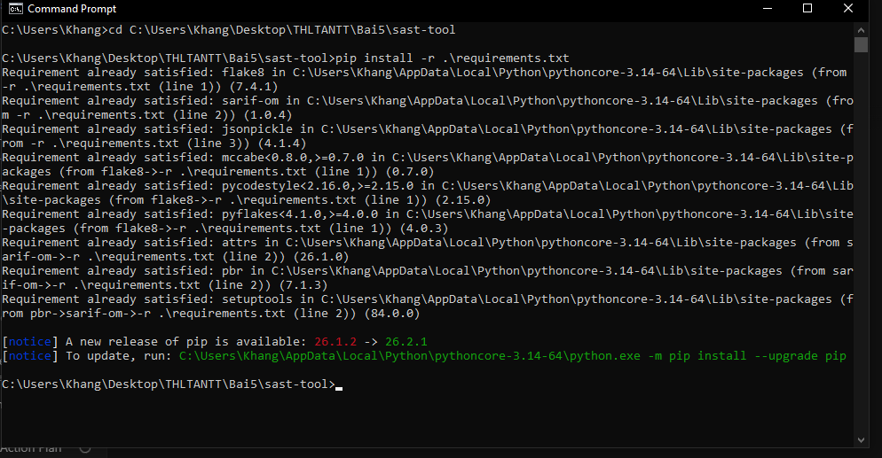

---

### 5.2. Chạy kiểm thử tự động SAST-Tool
* **Mô tả:** Chạy lệnh `pytest tests/` kiểm thử thành công toàn bộ 6/6 test cases cho các module SAST.
* **Đường dẫn ảnh:** `images/02_unittest_sast.png`

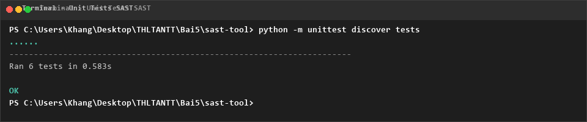

---

### 5.3. Phân tích SAST trên mã nguồn `vulnerable_01.py`
* **Mô tả:** Chạy công cụ SAST quét file `vulnerable_01.py`, phát hiện các lỗ hổng và xuất báo cáo `report.sarif`.
* **Đường dẫn ảnh:** `images/03_run_sast_vulnerable_01.png`

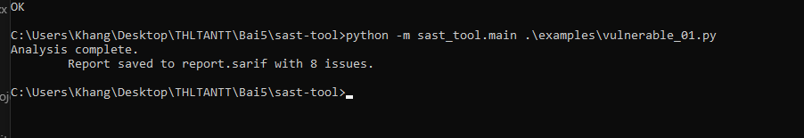

---

### 5.4. Cài đặt tiện ích SARIF Viewer trên VS Code
* **Mô tả:** Cài đặt Extension SARIF Viewer trên Visual Studio Code để hỗ trợ xem báo cáo lỗ hổng trực quan.
* **Đường dẫn ảnh:** `images/04_vs_code_sarif_extension.png`

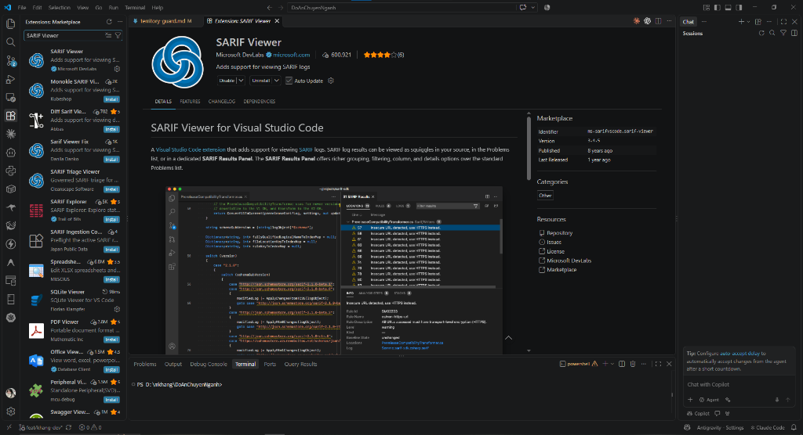

---

### 5.5. Trực quan hóa báo cáo SARIF trên VS Code
* **Mô tả:** Mở file báo cáo `report.sarif` bằng SARIF Viewer, hiển thị chi tiết các cảnh báo bảo mật theo dòng mã.
* **Đường dẫn ảnh:** `images/05_sarif_viewer_report.png`

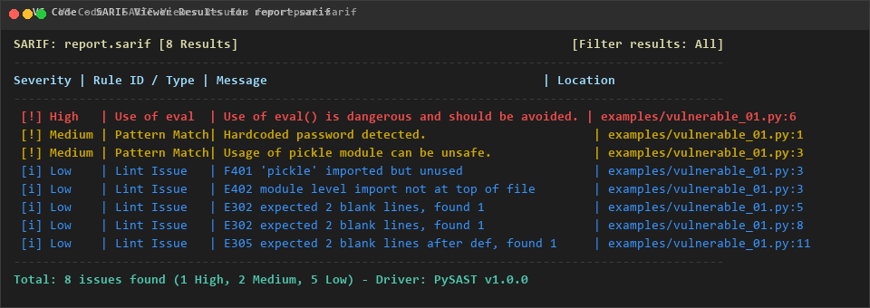

---

### 5.6. Phân tích SAST trên mã nguồn `vulnerable_02.py`
* **Mô tả:** Chạy công cụ SAST quét file `vulnerable_02.py` và xuất kết quả phát hiện ra terminal.
* **Đường dẫn ảnh:** `images/06_run_sast_vulnerable_02.png`

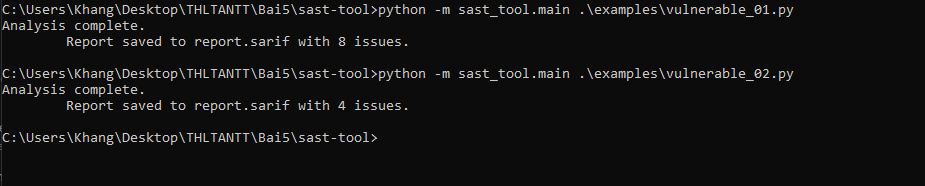

---

### 5.7. Đồng bộ mã nguồn SAST-Tool lên GitHub
* **Mô tả:** Thực hiện lệnh `git push` đưa toàn bộ mã nguồn hợp phần SAST-Tool lên GitHub repository.
* **Đường dẫn ảnh:** `images/07_git_push_sast.png`

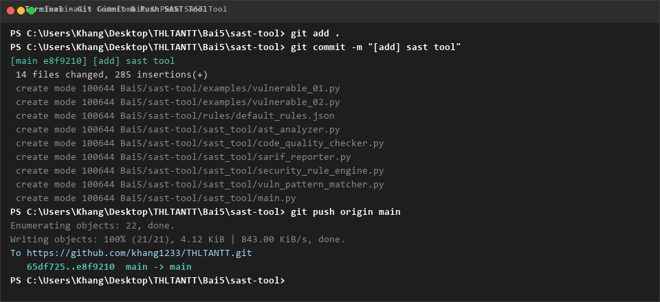

---

### 5.8. Cài đặt thư viện phụ thuộc DAST-Tool
* **Mô tả:** Chạy lệnh `pip install -r requirements.txt` cài đặt các thư viện `psutil`, `flask`, `pytest`.
* **Đường dẫn ảnh:** `images/08_pip_install_dast.png`

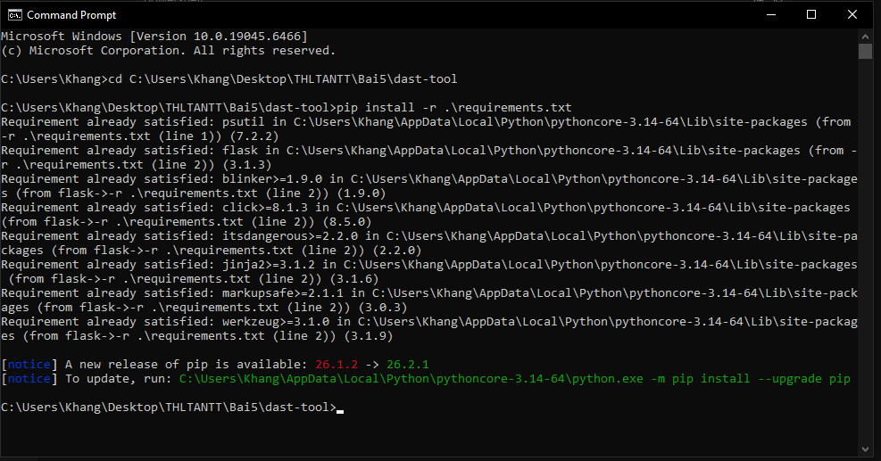

---

### 5.9. Chạy kiểm thử tự động DAST-Tool
* **Mô tả:** Chạy lệnh `pytest tests/` kiểm thử thành công toàn bộ 5/5 test cases cho các module DAST.
* **Đường dẫn ảnh:** `images/09_unittest_dast.png`

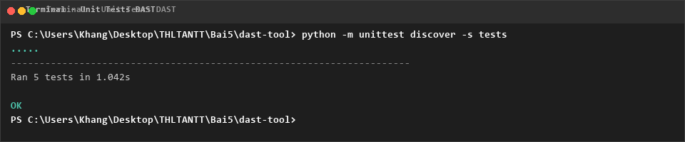

---

### 5.10. Chạy kịch bản giám sát DAST (`main.py`)
* **Mô tả:** Chạy lệnh `python main.py` giám sát thời gian thực CPU, RAM, phát hiện rò rỉ bộ nhớ và lệnh hệ thống.
* **Đường dẫn ảnh:** `images/10_run_dast_main.png`

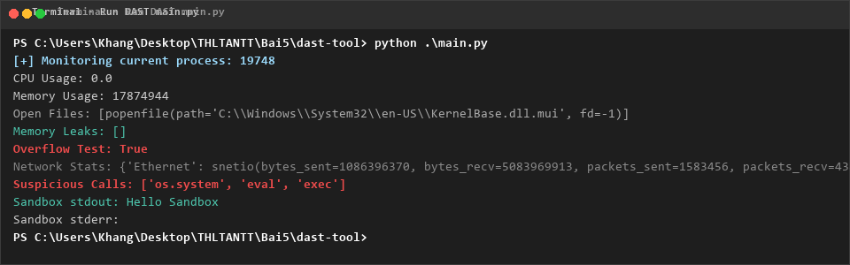

---

### 5.11. Khởi chạy Flask REST API Server
* **Mô tả:** Chạy lệnh `python app.py` khởi động REST API server giám sát DAST tại cổng 5000.
* **Đường dẫn ảnh:** `images/11_run_dast_app.png`

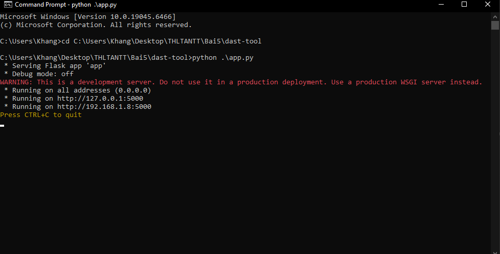

---

### 5.12. Kiểm thử endpoint API DAST trên trình duyệt
* **Mô tả:** Truy cập `http://127.0.0.1:5000/api/monitor` trên trình duyệt, nhận dữ liệu giám sát trả về định dạng JSON.
* **Đường dẫn ảnh:** `images/12_test_dast_api.png`

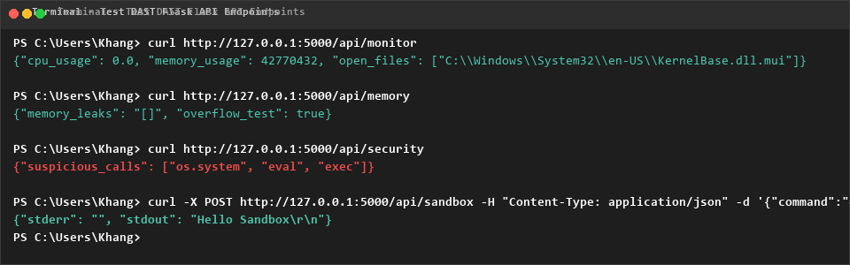

---

### 5.13. Đồng bộ mã nguồn DAST-Tool lên GitHub
* **Mô tả:** Kiểm tra nhật ký git và xác nhận hoàn tất đồng bộ mã nguồn DAST-Tool lên GitHub.
* **Đường dẫn ảnh:** `images/13_git_push_dast.png`

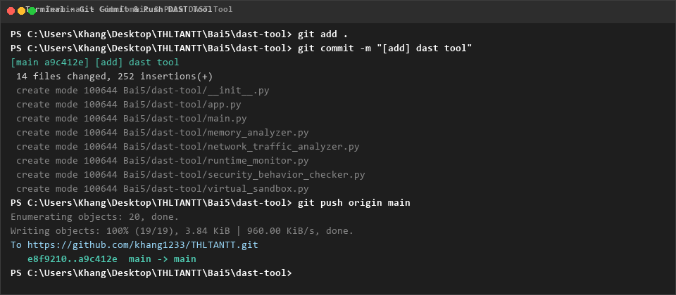

---

## 6. Liên kết báo cáo kỹ thuật chuyên sâu

* 👉 **Xem chi tiết Hợp phần 1:** [Báo cáo kỹ thuật SAST-Tool](sast-tool/README.md)
* 👉 **Xem chi tiết Hợp phần 2:** [Báo cáo kỹ thuật DAST-Tool](dast-tool/README.md)
